# How to use Loop

[English](#english) · [中文](#中文) · [Español](#español) · [हिन्दी](#हिन्दी) · [日本語](#日本語) · [Tiếng Việt](#tiếng-việt) · [Italiano](#italiano) · [한국어](#한국어)

---

## English

⬇ [Download on Google Play](https://play.google.com/store/apps/details?id=com.devnoyo0123.loop)

### What Loop is

A journal that brings your past thoughts back. Write what's on your mind, set a loop, and the log comes back to you when you chose.

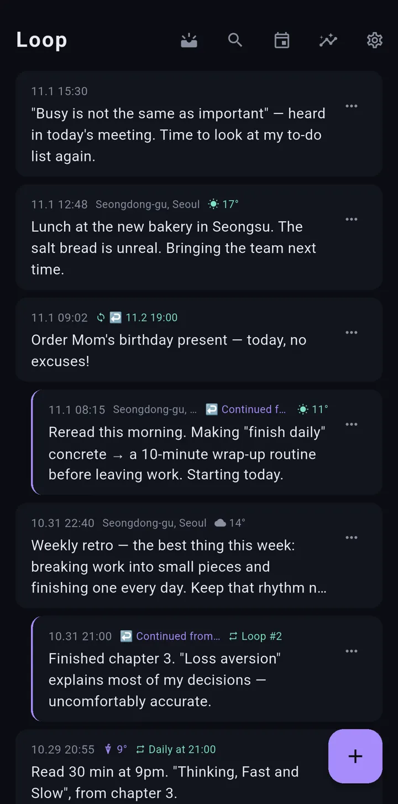

### 1. Write a log

Tap + at the bottom right to write what's on your mind. Attach photos or a video up to 1 minute. Place and weather are saved automatically (turn off in Settings › Location).

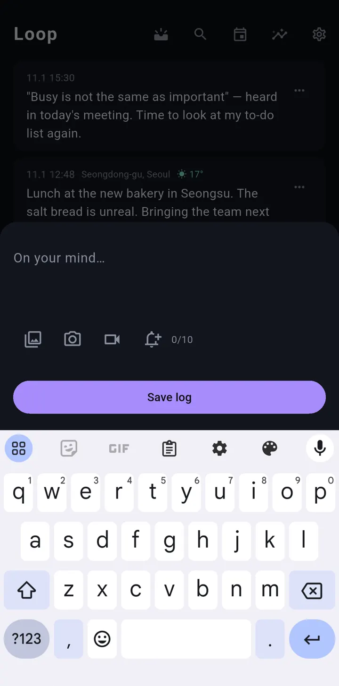

### 2. Set a loop — bring it back

Log ⋯ › ↩ Loop. 'Once' brings it back one time (a time based on the forgetting curve is suggested). A notification nudges once; an alarm rings until you dismiss it.

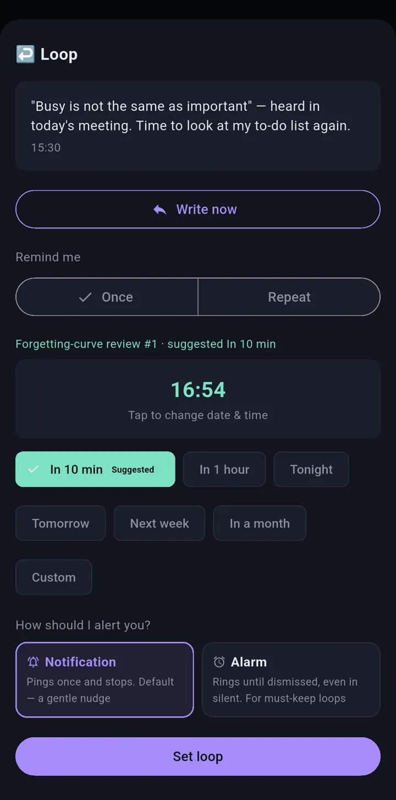

### 3. Repeating loops

Choose 'Repeat' in the loop sheet to bring it back every 10 minutes, daily, on weekdays, monthly and more. Each time, a spot to continue the log appears. To end it: ⋯ › Stop loop.

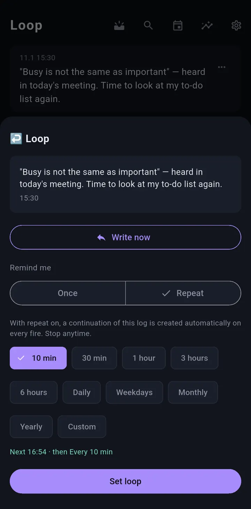

### 4. Continue and view the chain

Write on a log that came back and it joins a chain with a purple line. Use ⋯ › View loop chain to see it from the first log in one line. Tap 'Back to timeline' at the top to return.

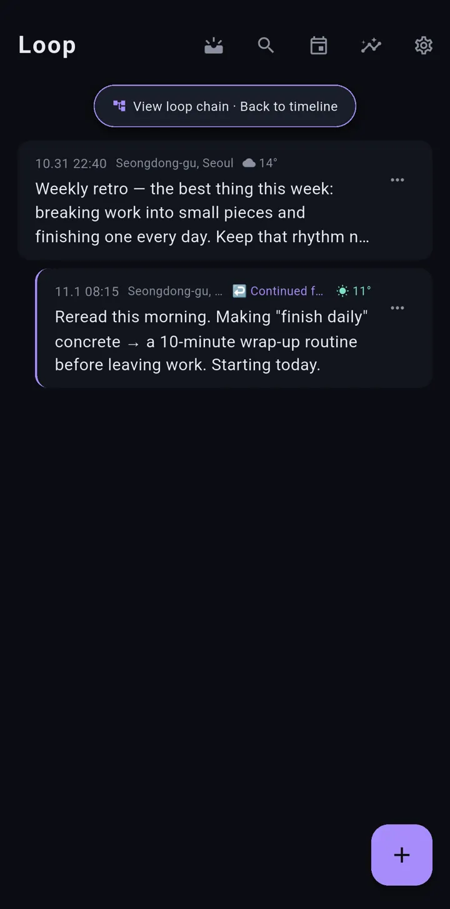

### 5. Upcoming 7 days

Tap the first icon at the top (Upcoming · 7 days) to see every loop coming back in the next 7 days.

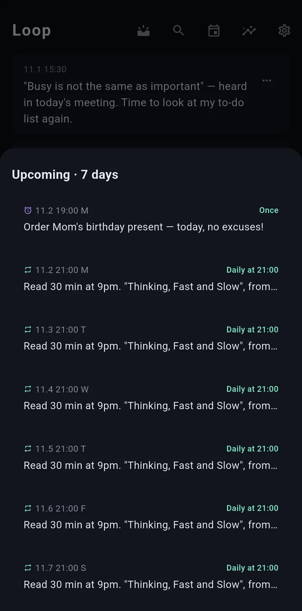

### 6. Morning and evening rhythm

Past self morning note: at 9 AM, logs from a week, a month and a year ago today. Day wrap-up time: the 'Tonight' chip and nightly loops use this time. Change both in Settings.

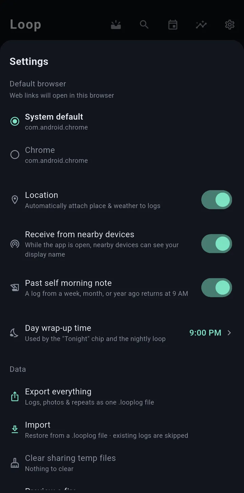

### 7. Share Loop — to the person next to you

Log ⋯ › Share Loop › Send to a nearby device. It goes straight to the phone next to you, with no internet or server. The receiver turns on Settings › Receive from nearby devices. Location is left out by default.

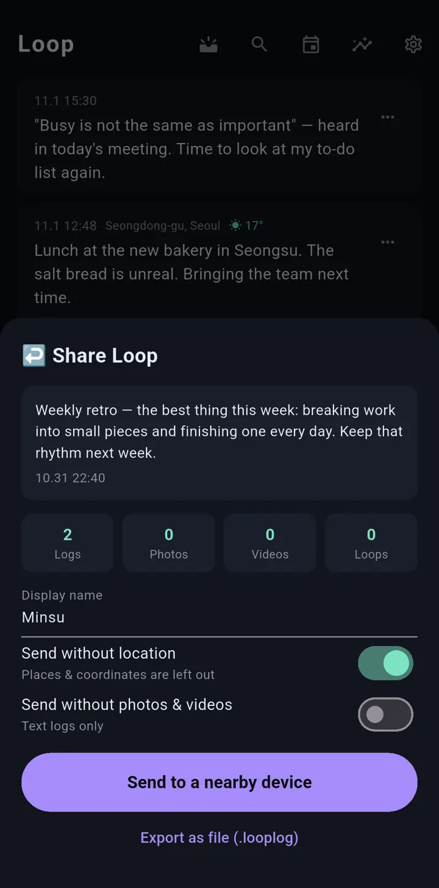

### 8. Backup — export and import

Settings › Export everything saves logs, photos, videos and repeats into one .looplog file. On a new phone, use Settings › Import — logs you already have are skipped. Export now and then.

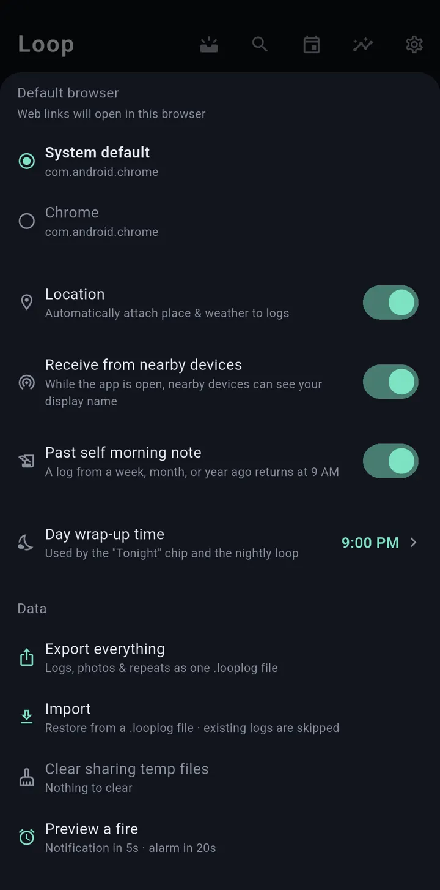

### 9. Your flow, search and dates

Use the icons at the top. Search finds content and places, Jump to date opens that day, and Your flow shows how often thoughts came back, your streaks and your longest chains.

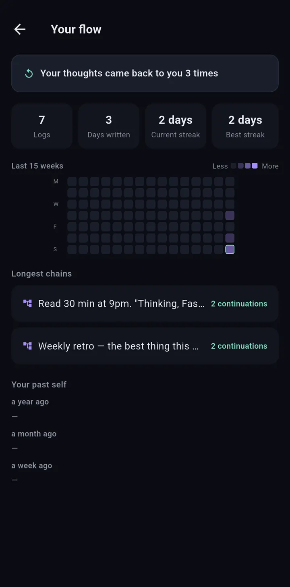

### 10. Let alarms show on screen

For alarms to appear over the lock screen, allow 'full-screen notifications'. When Loop asks, tap Open settings and turn Loop on. Without it, alarms only make a sound. Try Settings › Preview a fire.

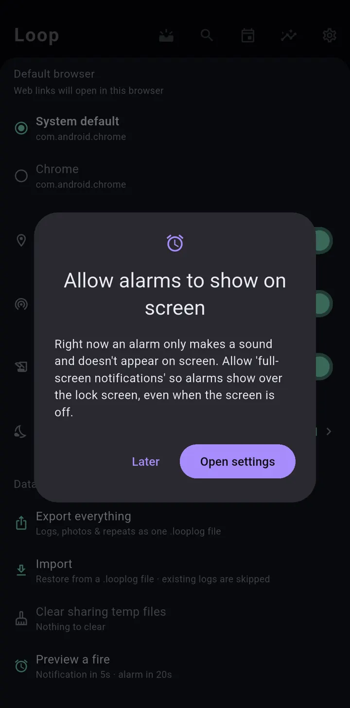
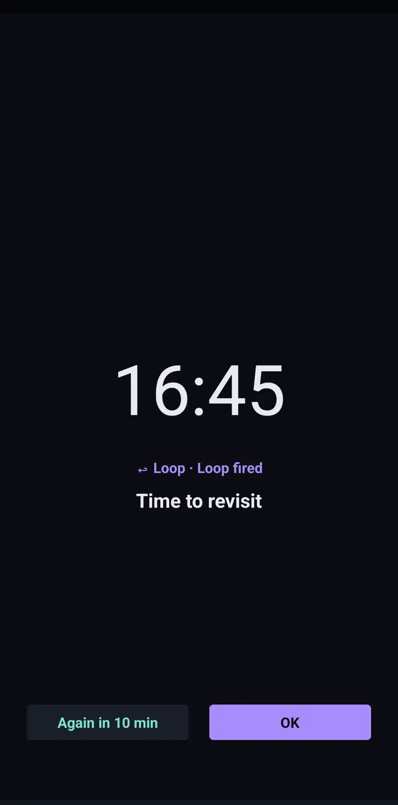

---

## 中文

⬇ [在 Google Play 中下载](https://play.google.com/store/apps/details?id=com.devnoyo0123.loop)

### Loop 是什么

一本让过去的想法重新回来的记录本。写下此刻的想法并设置循环，到了你定的时间，这条记录会再次出现。

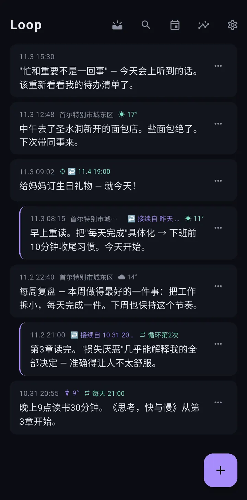

### 1. 写记录

点按右下角的 + 写下此刻的想法。可以附上照片或 1 分钟以内的视频，地点和天气会自动保存（可在 设置 › 位置记录 中关闭）。

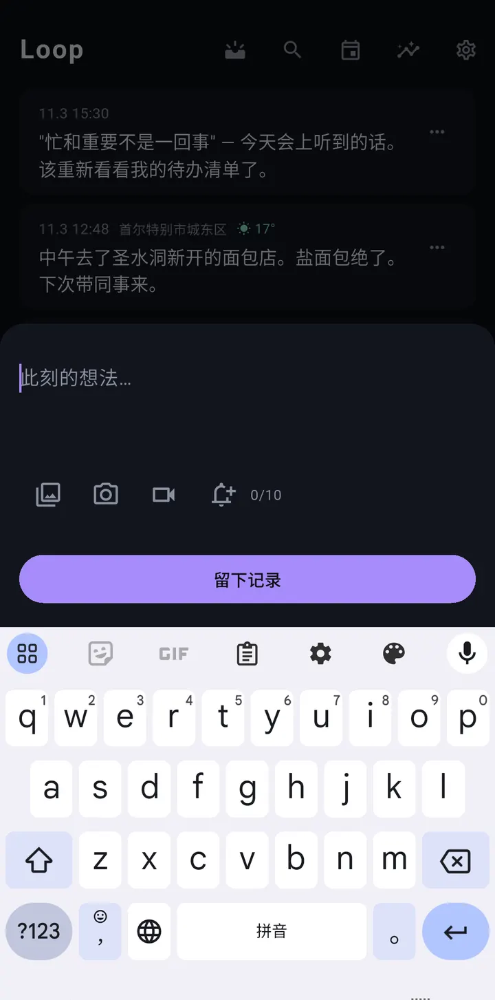

### 2. 设置循环 — 让它回来

记录的 ⋯ › ↩ 循环。“一次”会在指定时间回来一次（会按遗忘曲线推荐时间）。通知安静地提醒一次，闹钟会一直响到你确认。

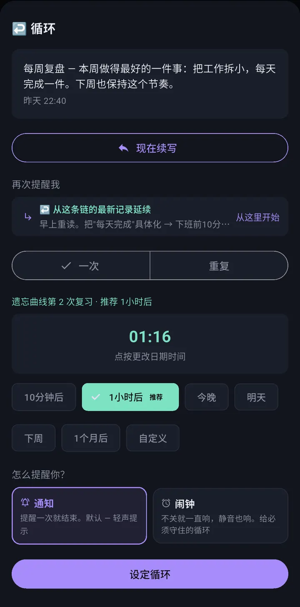

### 3. 重复循环

在循环面板中选择“重复”，就会每 10 分钟、每天、工作日、每月等持续回来。每次回来都会留出续写的位置。要停止：⋯ › 停止循环。

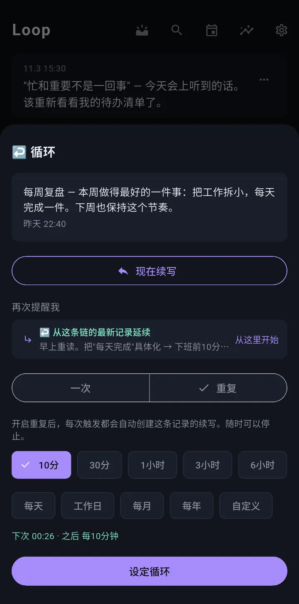

### 4. 续写与查看循环

在回来的记录上续写，会形成用紫色线连接的链。⋯ › 查看循环 可把从第一条到现在的记录排成一行。点按顶部按钮返回全部时间线。

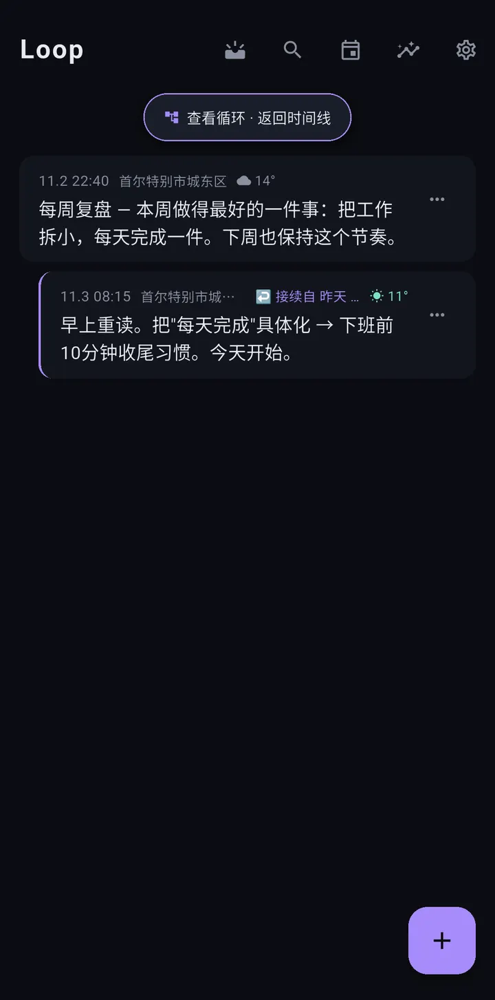

### 5. 未来 7 天

点按顶部第一个图标（即将到来的循环 · 7天），即可一眼看到今天起 7 天内会回来的循环。

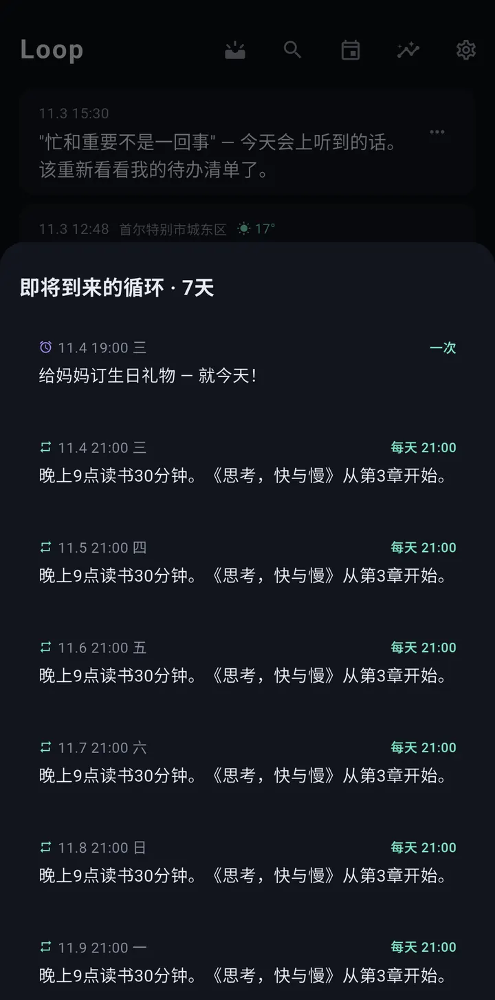

### 6. 早晚节奏

那时的你 早间提醒：早上 9 点带来 1 周、1 个月、1 年前今天的记录。一天收尾时间：“今晚”标签和每晚的循环都使用这个时间。两者都可在设置中修改。

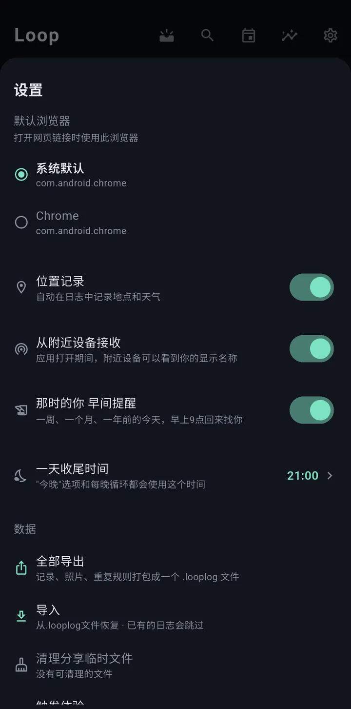

### 7. 分享循环 — 给身边的人

记录的 ⋯ › 分享循环 › 发送到附近设备。无需互联网和服务器，直接送到身边的手机。接收方请打开 设置 › 从附近设备接收。默认不发送位置。

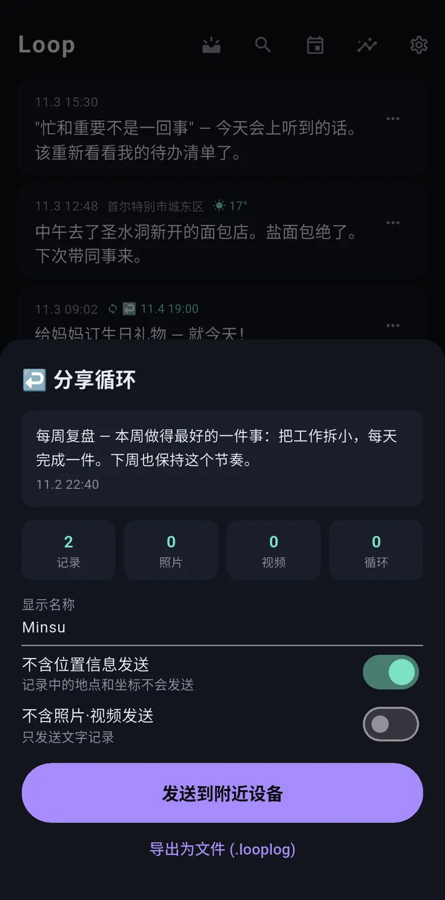

### 8. 备份 — 全部导出与导入

设置 › 全部导出 会把记录、照片、视频和重复设置保存成一个 .looplog 文件。在新手机上用 设置 › 导入，已有的记录会被跳过。记得不时导出一次。

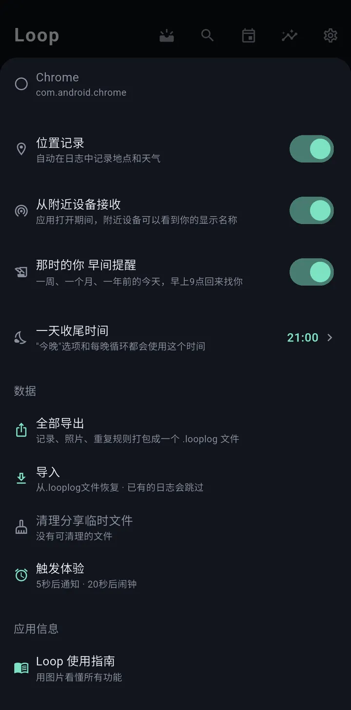

### 9. 记录轨迹 · 搜索 · 跳转到日期

用顶部图标查找：搜索按内容和地点查找，跳转到日期直接到那一天，记录轨迹显示想法回来的次数、连续记录和最长的链。

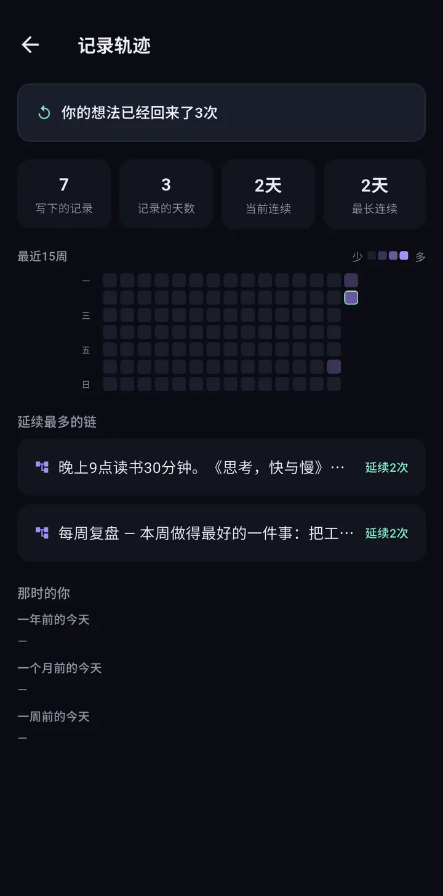

### 10. 让闹钟显示在屏幕上

要让闹钟显示在锁屏之上，需要允许“全屏通知”。出现提示时点按 打开设置 › 开启 Loop。关闭时闹钟只会响铃。可以用 设置 › 触发体验 试一试。

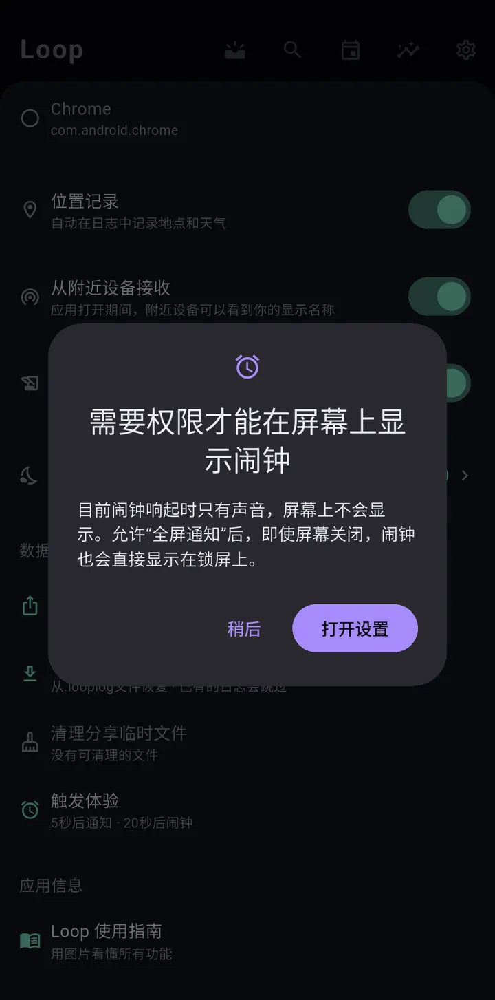
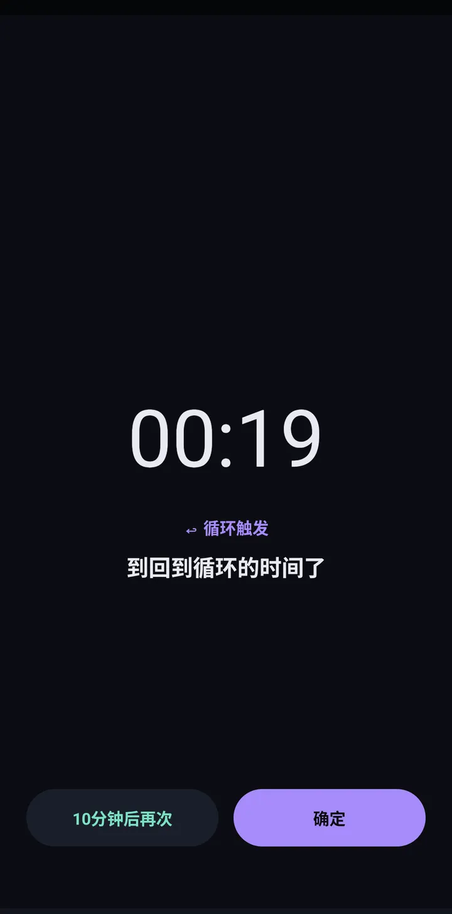

---

## Español

⬇ [Descargar en Google Play](https://play.google.com/store/apps/details?id=com.devnoyo0123.loop)

### Qué es Loop

Un diario que hace volver tus pensamientos pasados. Escribe lo que piensas, crea un bucle y el registro vuelve cuando tú elijas.

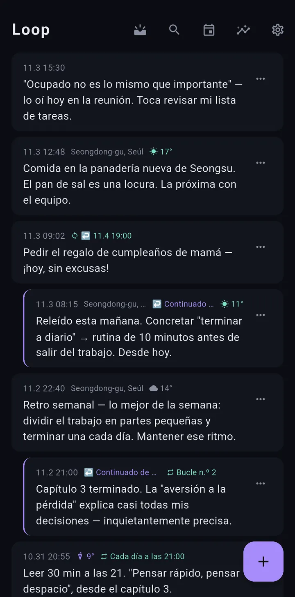

### 1. Escribir un registro

Toca + abajo a la derecha para escribir lo que piensas. Adjunta fotos o un vídeo de hasta 1 minuto. El lugar y el tiempo se guardan solos (desactívalo en Ajustes › Ubicación).

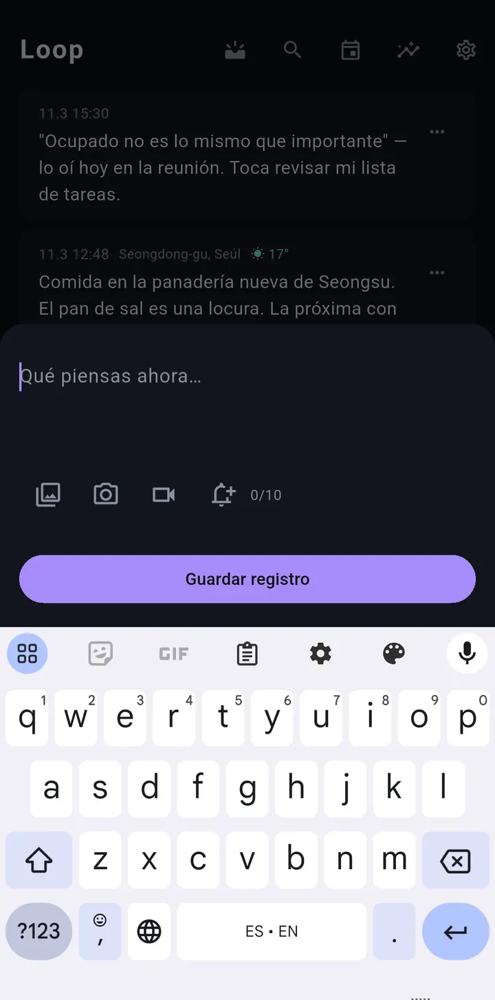

### 2. Crear un bucle — que vuelva

Registro ⋯ › ↩ Bucle. 'Una vez' lo trae de vuelta una vez (se sugiere una hora según la curva del olvido). Una notificación avisa una vez; una alarma suena hasta que la confirmas.

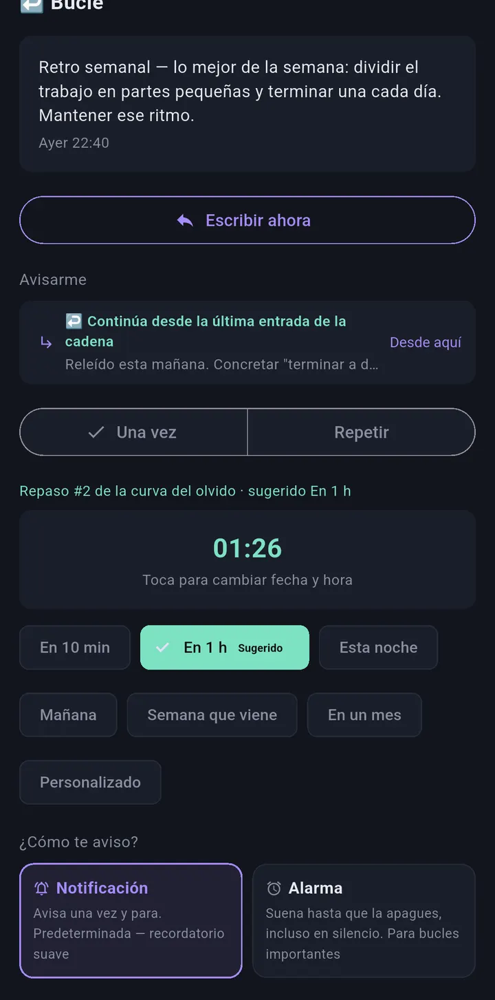

### 3. Bucles que se repiten

Elige 'Repetir' para que vuelva cada 10 minutos, a diario, entre semana, cada mes y más. Cada vez aparece un hueco para continuar el registro. Para terminar: ⋯ › Detener bucle.

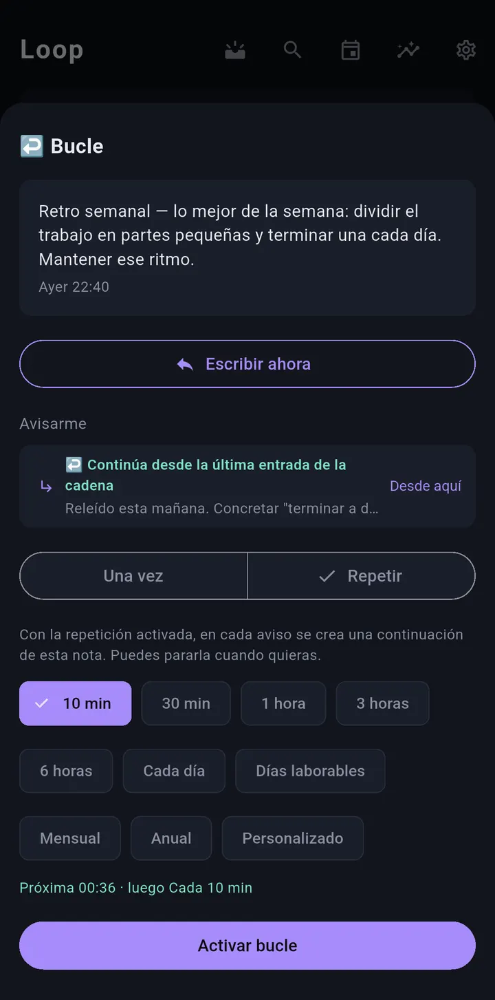

### 4. Continuar y ver la cadena

Escribe sobre un registro que volvió y se une a una cadena con una línea morada. Con ⋯ › Ver bucle lo ves desde el primer registro en una sola línea. El botón de arriba te devuelve a la línea de tiempo.

### 5. Próximos 7 días

Toca el primer icono de arriba (Próximos · 7 días) para ver todos los bucles que volverán en los próximos 7 días.

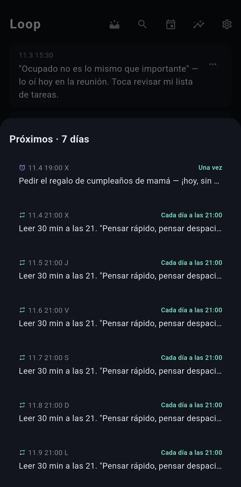

### 6. Ritmo de mañana y noche

Nota matinal del pasado: a las 9 h, registros de hace una semana, un mes y un año. Hora de cierre del día: la etiqueta 'Esta noche' y los bucles nocturnos usan esta hora. Cambia ambas en Ajustes.

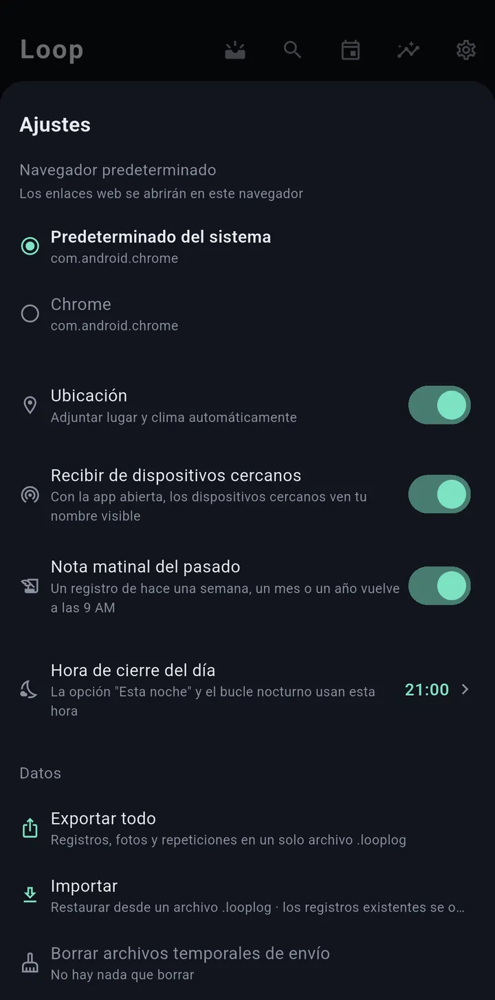

### 7. Compartir bucle — a quien tienes al lado

Registro ⋯ › Compartir bucle › Enviar a un dispositivo cercano. Llega directo al teléfono de al lado, sin internet ni servidor. Quien recibe activa Ajustes › Recibir de dispositivos cercanos. La ubicación se excluye por defecto.

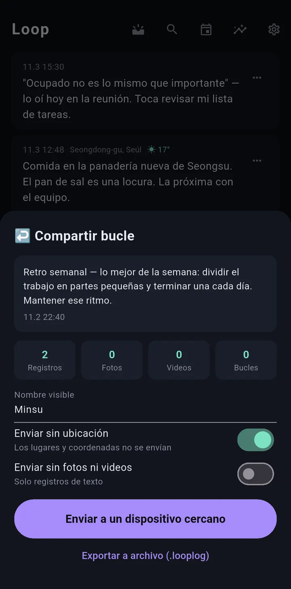

### 8. Copia — exportar e importar

Ajustes › Exportar todo guarda registros, fotos, vídeos y repeticiones en un archivo .looplog. En un teléfono nuevo usa Ajustes › Importar; se omiten los registros que ya tienes. Exporta de vez en cuando.

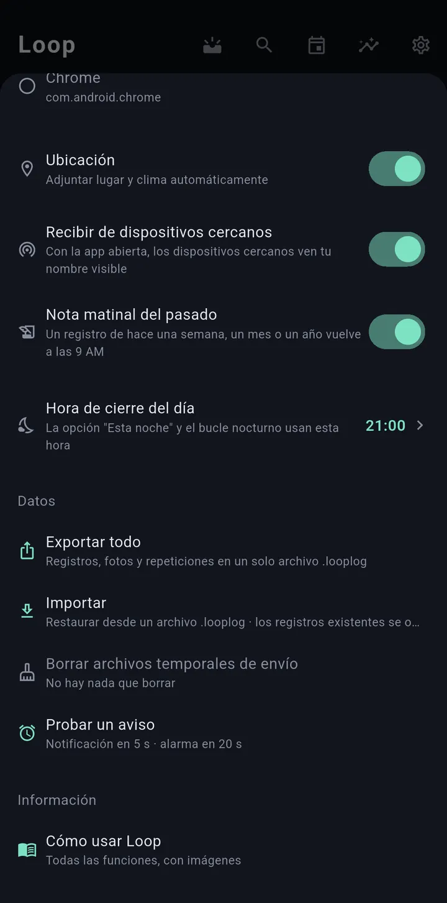

### 9. Tu flujo, búsqueda y fechas

Usa los iconos de arriba. Buscar encuentra contenido y lugares, Ir a una fecha abre ese día y Tu flujo muestra cuántas veces volvieron tus ideas, tus rachas y tus cadenas más largas.

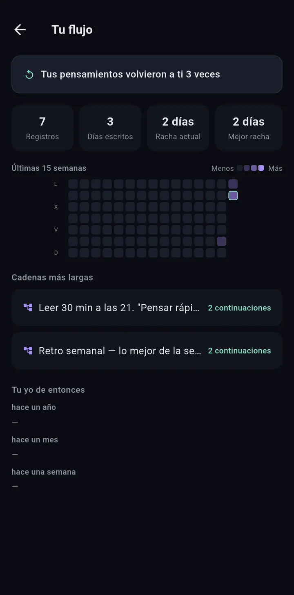

### 10. Que las alarmas aparezcan en pantalla

Para que las alarmas aparezcan sobre la pantalla de bloqueo, permite las 'notificaciones a pantalla completa'. Cuando Loop lo pida, toca Abrir ajustes y activa Loop. Sin eso, solo suenan. Pruébalo con Ajustes › Probar un aviso.

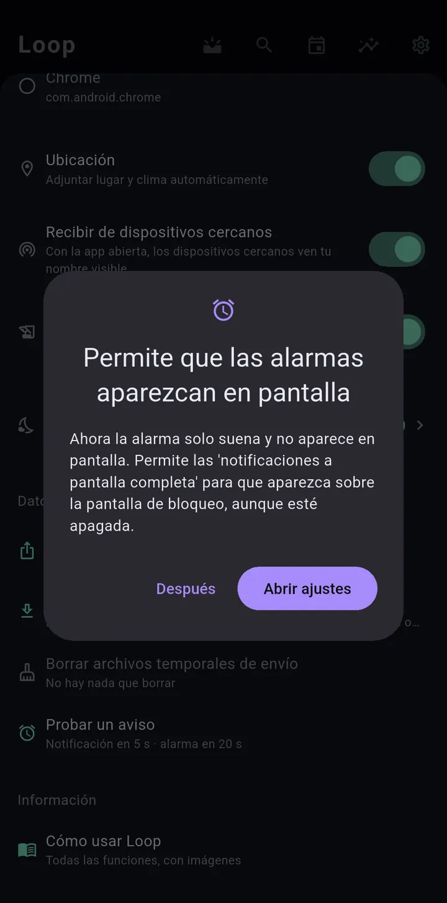
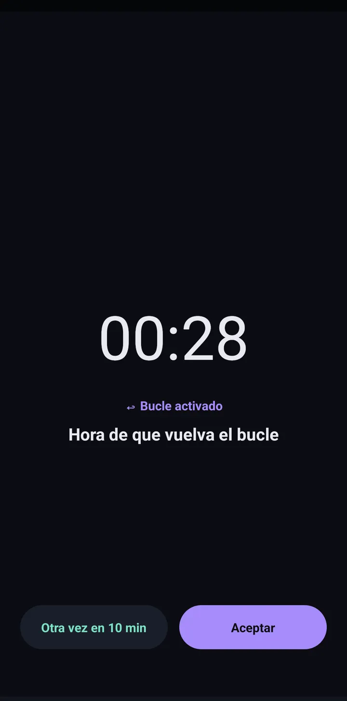

---

## हिन्दी

⬇ [Google Play पर डाउनलोड करें](https://play.google.com/store/apps/details?id=com.devnoyo0123.loop)

### Loop क्या है

एक डायरी जो आपके बीते विचारों को फिर से लौटाती है। अभी का विचार लिखें, लूप लगाएं, और तय समय पर वह लॉग फिर आपके पास आएगा।

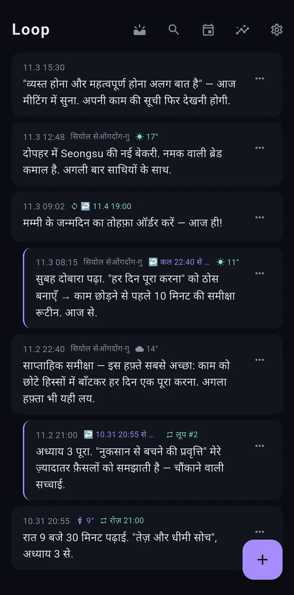

### 1. लॉग लिखें

नीचे दाईं ओर + दबाकर अभी का विचार लिखें। फ़ोटो या 1 मिनट तक का वीडियो जोड़ सकते हैं। जगह और मौसम अपने आप सहेजे जाते हैं (सेटिंग में बंद कर सकते हैं)।

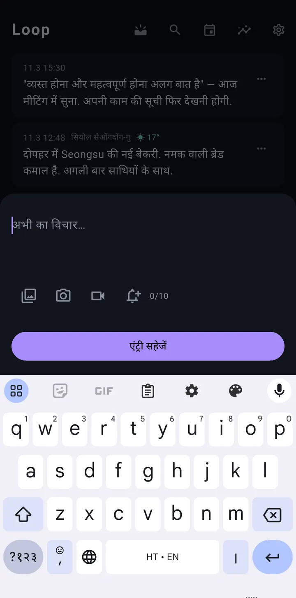

### 2. लूप लगाएं — फिर लौटाएं

लॉग का ⋯ › ↩ Loop। 'एक बार' तय समय पर एक बार लौटाता है (भूलने के वक्र के हिसाब से समय सुझाया जाता है)। नोटिफिकेशन एक बार याद दिलाता है; अलार्म पुष्टि करने तक बजता है।

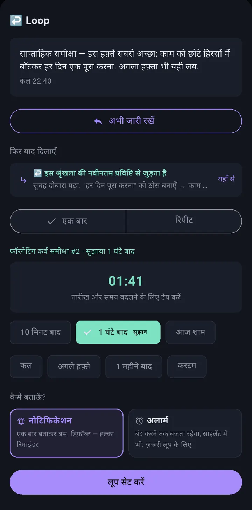

### 3. रिपीट लूप

लूप शीट में 'रिपीट' चुनें तो हर 10 मिनट, रोज़, कार्यदिवस, हर महीने आदि पर लौटता रहेगा। हर बार आगे लिखने की जगह बनती है। रोकने के लिए: ⋯ › लूप रोकें।

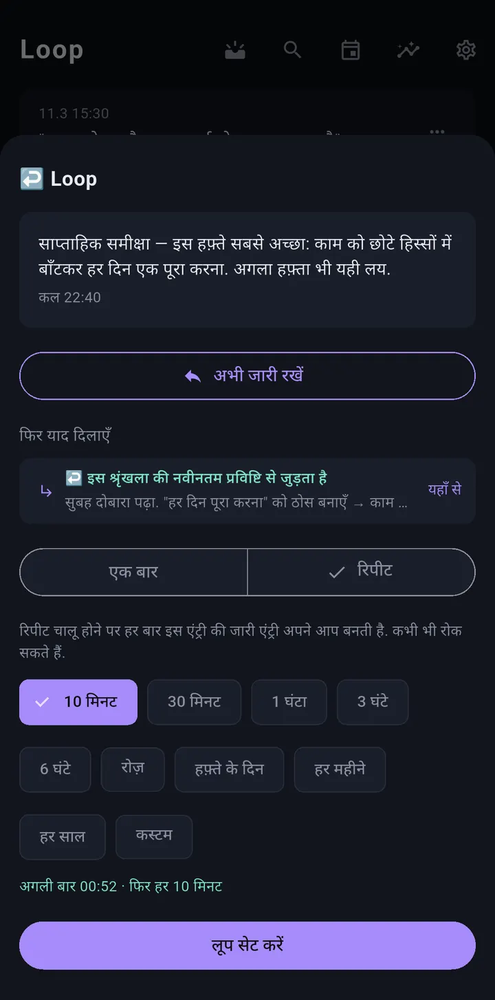

### 4. आगे लिखें और श्रृंखला देखें

लौटे हुए लॉग पर आगे लिखने से बैंगनी रेखा से जुड़ी श्रृंखला बनती है। ⋯ › लूप श्रृंखला देखें से पहले लॉग से अब तक एक लाइन में देखें। ऊपर का बटन पूरी टाइमलाइन पर लौटाता है।

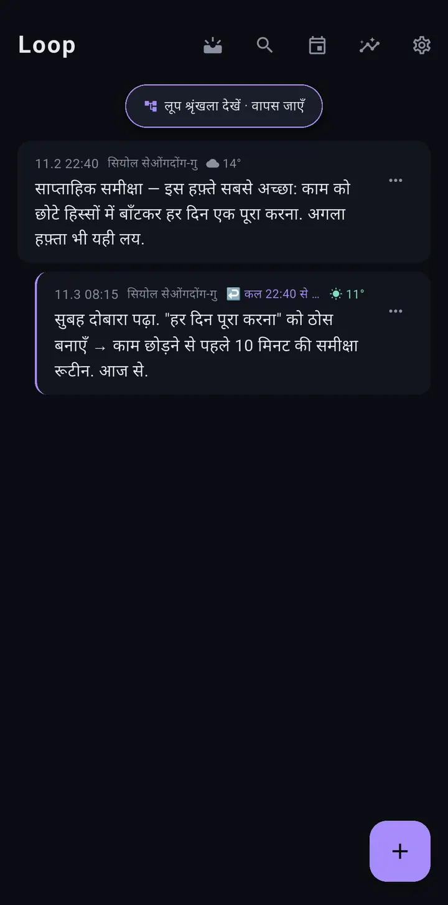

### 5. आने वाले 7 दिन

ऊपर पहला आइकन (आने वाले लूप · 7 दिन) दबाएं — आज से 7 दिनों में लौटने वाले सभी लूप एक नज़र में दिखेंगे।

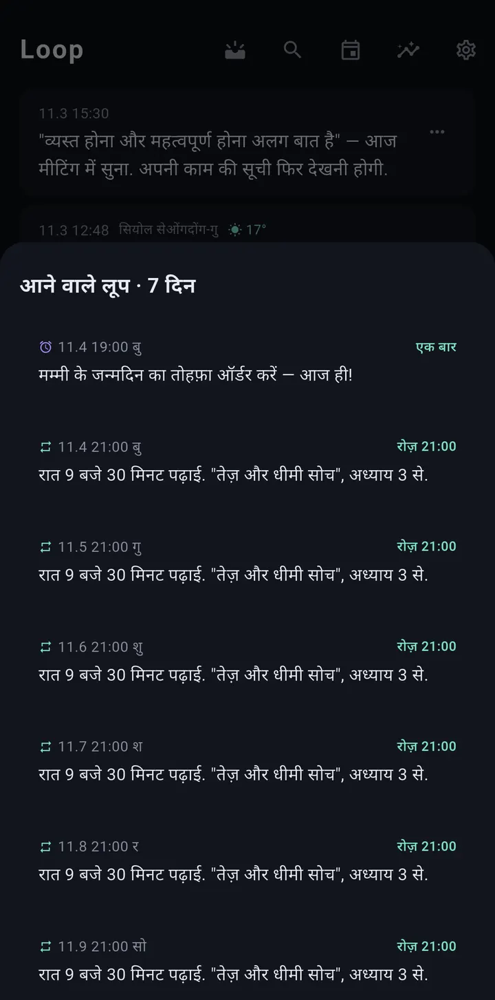

### 6. सुबह और शाम की लय

सुबह 9 बजे Loop आपको 1 हफ़्ते, 1 महीने और 1 साल पहले आज के लॉग सुनाता है। दिन खत्म होने का समय शाम के सुझाव और रात के लूप के लिए इस्तेमाल होता है। दोनों सेटिंग में बदलें।

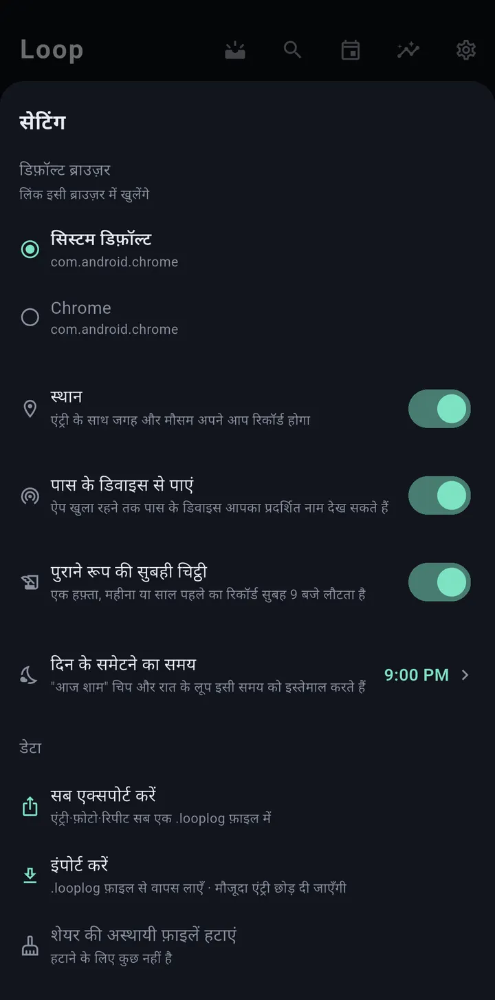

### 7. Loop साझा करें — पास वाले को

लॉग का ⋯ › Loop साझा करें › पास के डिवाइस पर भेजें। बिना इंटरनेट या सर्वर के सीधे पास के फ़ोन पर जाता है। पाने वाला सेटिंग › पास के डिवाइस से पाएं चालू करे। जगह डिफ़ॉल्ट रूप से नहीं भेजी जाती।

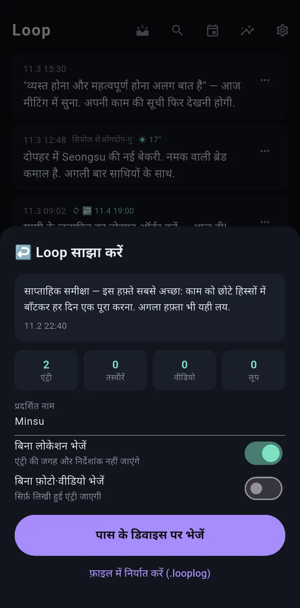

### 8. बैकअप — एक्सपोर्ट और इंपोर्ट

सेटिंग › सब एक्सपोर्ट करें से लॉग, फ़ोटो, वीडियो और रिपीट एक .looplog फ़ाइल में सहेजें। नए फ़ोन पर सेटिंग › इंपोर्ट करें — पहले से मौजूद लॉग छोड़ दिए जाते हैं। समय-समय पर एक्सपोर्ट करते रहें।

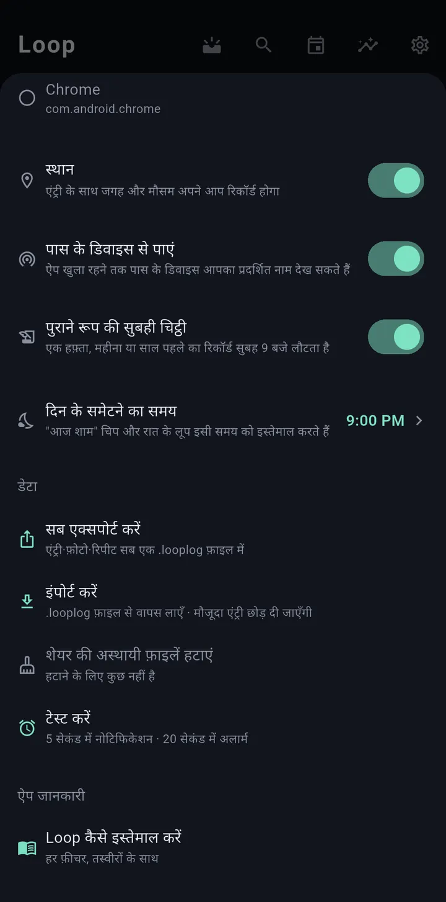

### 9. रिकॉर्ड फ़्लो · खोज · तारीख

ऊपर के आइकन से खोजें: खोज टेक्स्ट और जगह से, तारीख पर जाएँ उसी दिन पर, और रिकॉर्ड फ़्लो दिखाता है कि विचार कितनी बार लौटे, लगातार दिन और सबसे लंबी श्रृंखला।

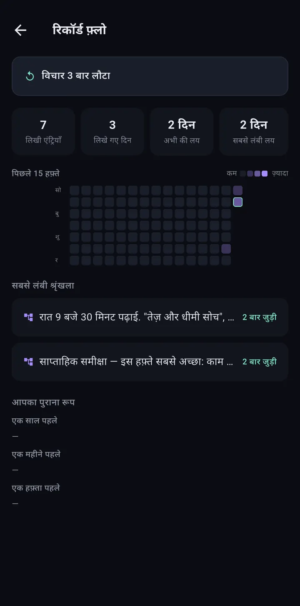

### 10. अलार्म स्क्रीन पर दिखाएं

अलार्म लॉक स्क्रीन के ऊपर दिखे, इसके लिए 'फ़ुल-स्क्रीन सूचनाएं' की अनुमति दें। पूछे जाने पर सेटिंग खोलें › Loop चालू करें। बंद होने पर अलार्म सिर्फ़ बजता है। सेटिंग › टेस्ट करें से आज़माएं।

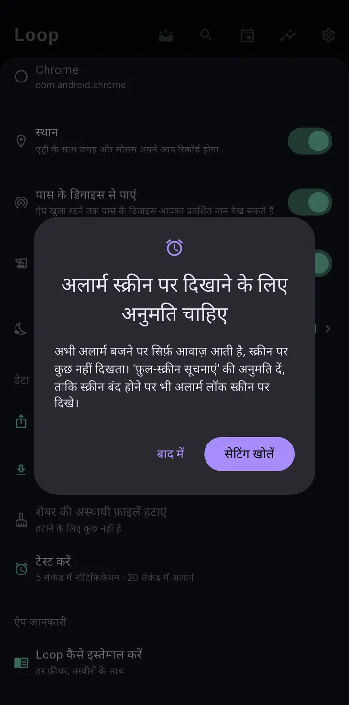
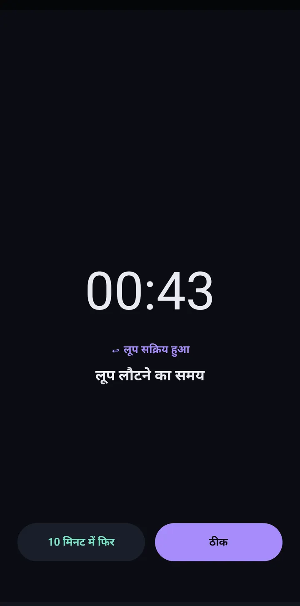

---

## 日本語

⬇ [Google Play でダウンロード](https://play.google.com/store/apps/details?id=com.devnoyo0123.loop)

### Loopとは

過ぎた考えをもう一度呼び戻す記録帳です。今の考えを書いてループをかけておくと、決めたときにその記録が戻ってきます。

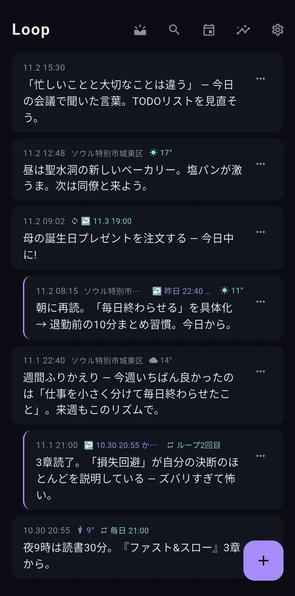

### 1. 記録を書く

右下の + をタップして今の考えを書きます。写真や1分以内の動画を添付でき、場所と天気は自動で残ります（設定 › 位置の記録でオフにできます）。

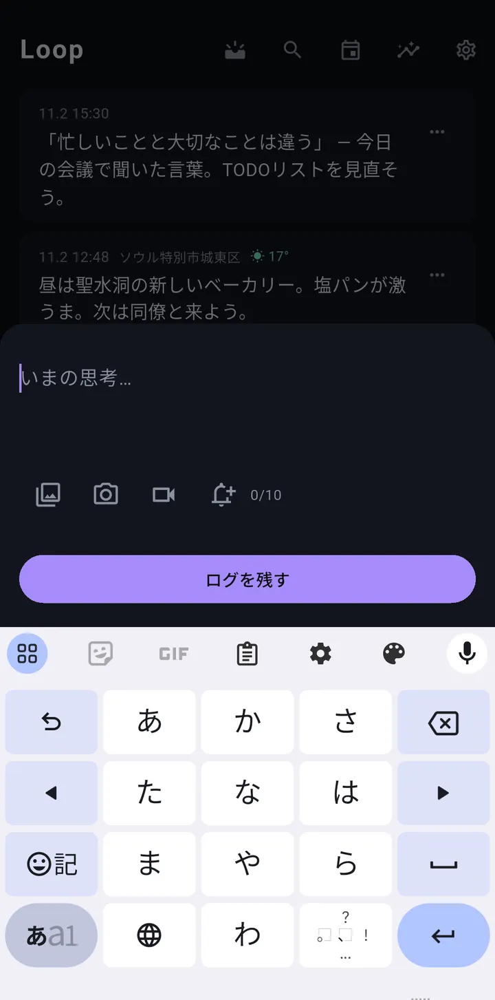

### 2. ループをかける — もう一度戻す

記録の ⋯ › ↩ ループ。「1回」は決めた時刻に一度戻ってきます（忘却曲線に合わせた時刻をおすすめします）。通知は静かに一度、アラームは確認するまで鳴ります。

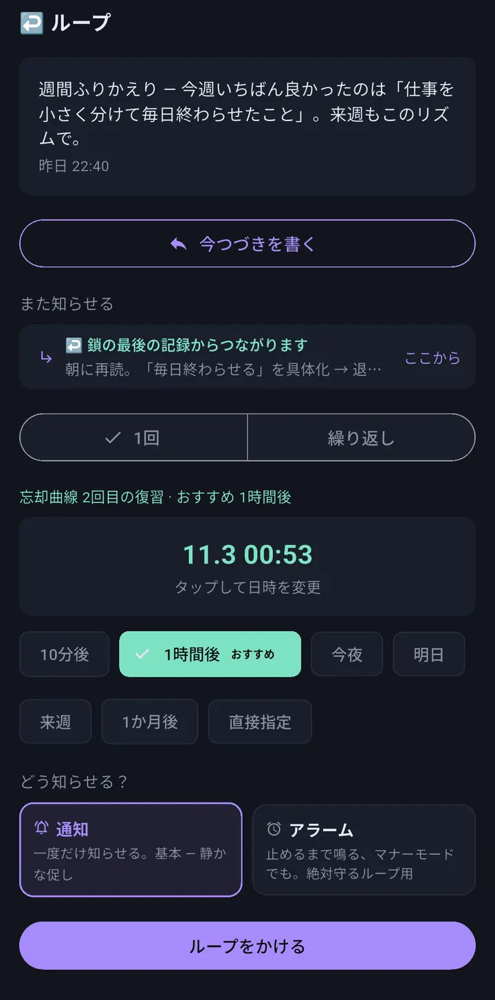

### 3. 繰り返しループ

ループシートで「繰り返し」を選ぶと、10分ごと・毎日・平日・毎月などで戻り続けます。戻るたびに続きを書く場所ができます。やめるには ⋯ › ループを止める。

### 4. 続きを書く・ループを見る

戻ってきた記録に続きを書くと、紫の線でつながったチェーンになります。⋯ › ループを見る で最初の記録から一列で見られます。上のボタンで全体に戻ります。

### 5. 今後の7日間

上部の最初のアイコン（今後のループ · 7日）をタップすると、今日から7日間に戻ってくるループが一目でわかります。

### 6. 朝と夜のリズム

あの日の自分 朝の通知：朝9時に1週間・1か月・1年前の今日の記録を届けます。一日の締め時刻：「今夜」チップと毎晩のループがこの時刻を使います。どちらも設定で変更できます。

### 7. ループを共有 — 隣の人へ

記録の ⋯ › ループを共有 › 近くのデバイスに送る。インターネットやサーバーを通さず隣のスマホへ直接届きます。受け取る側は 設定 › 近くのデバイスから受け取る をオンに。位置は初期設定で除いて送ります。

### 8. バックアップ — エクスポートと読み込み

設定 › すべてエクスポート で記録・写真・動画・繰り返しを .looplog ファイル1つに保存します。新しいスマホでは 設定 › 読み込む。すでにある記録はスキップされます。ときどきエクスポートしておきましょう。

### 9. 記録の流れ・検索・日付へ移動

上部のアイコンで探せます。検索は内容・場所で、日付へ移動はその日へ。記録の流れでは戻ってきた回数、連続記録、いちばん長いチェーンが見られます。

### 10. アラームを画面に表示する

アラームをロック画面の上に表示するには「全画面通知」の許可が必要です。案内が出たら 設定を開く › Loop をオン。オフのままだと音だけ鳴ります。設定 › 発火テスト で試せます。

---

## Tiếng Việt

⬇ [Tải xuống trên Google Play](https://play.google.com/store/apps/details?id=com.devnoyo0123.loop)

### Loop là gì

Cuốn sổ giúp những suy nghĩ đã qua quay trở lại. Ghi điều bạn đang nghĩ, đặt vòng lặp, và ghi chép sẽ quay lại đúng lúc bạn chọn.

### 1. Viết ghi chép

Chạm + ở góc dưới bên phải để ghi điều bạn đang nghĩ. Có thể đính kèm ảnh hoặc video dưới 1 phút. Địa điểm và thời tiết được lưu tự động (tắt trong Cài đặt › Vị trí).

### 2. Đặt vòng lặp — cho nó quay lại

Ghi chép ⋯ › ↩ Vòng lặp. 'Một lần' quay lại một lần (gợi ý giờ theo đường cong quên lãng). Thông báo nhắc nhẹ một lần; báo thức reo cho đến khi bạn xác nhận.

### 3. Vòng lặp lặp lại

Chọn 'Lặp lại' để ghi chép quay lại mỗi 10 phút, hằng ngày, ngày thường, hằng tháng… Mỗi lần quay lại sẽ có chỗ để viết tiếp. Để dừng: ⋯ › Dừng vòng lặp.

### 4. Viết tiếp và xem vòng lặp

Viết tiếp trên ghi chép vừa quay lại để tạo chuỗi nối bằng đường màu tím. ⋯ › Xem vòng lặp cho thấy từ ghi chép đầu tiên trên một dòng. Nút phía trên đưa bạn về dòng thời gian.

### 5. 7 ngày tới

Chạm biểu tượng đầu tiên phía trên (Sắp tới · 7 ngày) để xem mọi vòng lặp sẽ quay lại trong 7 ngày tới.

### 6. Nhịp sáng và tối

Lời nhắn buổi sáng từ quá khứ: 9 giờ sáng, ghi chép của 1 tuần, 1 tháng, 1 năm trước. Giờ khép lại của ngày: nhãn 'Tối nay' và vòng lặp mỗi tối dùng giờ này. Đổi cả hai trong Cài đặt.

### 7. Chia sẻ vòng lặp — cho người bên cạnh

Ghi chép ⋯ › Chia sẻ vòng lặp › Gửi tới thiết bị gần đây. Đến thẳng điện thoại bên cạnh, không cần internet hay máy chủ. Người nhận bật Cài đặt › Nhận từ thiết bị gần đây. Mặc định không gửi vị trí.

### 8. Sao lưu — xuất và nhập

Cài đặt › Xuất tất cả lưu ghi chép, ảnh, video và lặp lại vào một tệp .looplog. Trên máy mới dùng Cài đặt › Nhập; ghi chép đã có sẽ được bỏ qua. Thỉnh thoảng hãy xuất một lần.

### 9. Dòng chảy, tìm kiếm và ngày

Dùng các biểu tượng phía trên. Tìm kiếm theo nội dung và địa điểm, Đến ngày mở đúng ngày đó, Dòng chảy của bạn cho thấy số lần suy nghĩ quay lại, chuỗi liên tục và chuỗi dài nhất.

### 10. Cho báo thức hiện trên màn hình

Để báo thức hiện trên màn hình khóa, hãy cho phép 'thông báo toàn màn hình'. Khi Loop nhắc, chạm Mở cài đặt rồi bật Loop. Nếu tắt, báo thức chỉ phát âm thanh. Thử bằng Cài đặt › Thử kích hoạt.

---

## Italiano

⬇ [Scarica su Google Play](https://play.google.com/store/apps/details?id=com.devnoyo0123.loop)

### Cos'è Loop

Un diario che fa tornare i tuoi pensieri passati. Scrivi quello che pensi, imposta un loop e la nota torna quando hai scelto.

### 1. Scrivere una nota

Tocca + in basso a destra per scrivere quello che pensi. Allega foto o un video fino a 1 minuto. Luogo e meteo vengono salvati da soli (disattivabili nelle Impostazioni).

### 2. Impostare un loop — farla tornare

Nota ⋯ › ↩ Loop. 'Una volta' la fa tornare una volta (viene suggerito un orario secondo la curva dell'oblio). Una notifica avvisa una volta; una sveglia suona finché non confermi.

### 3. Loop ripetuti

Scegli 'Ripeti' per farla tornare ogni 10 minuti, ogni giorno, nei giorni feriali, ogni mese e altro. Ogni volta compare uno spazio per continuare. Per finire: ⋯ › Ferma il loop.

### 4. Continuare e vedere la catena

Scrivi su una nota tornata e si unisce a una catena con una linea viola. Con ⋯ › Vedi la catena la vedi dalla prima nota in una sola riga. Il pulsante in alto ti riporta alla timeline.

### 5. Prossimi 7 giorni

Tocca la prima icona in alto (In arrivo · 7 giorni) per vedere tutti i loop che torneranno nei prossimi 7 giorni.

### 6. Ritmo di mattina e sera

Alle 9 del mattino Loop ti riporta le note di una settimana, un mese e un anno fa. L'orario di fine giornata serve ai suggerimenti serali e ai loop notturni. Cambiali entrambi nelle Impostazioni.

### 7. Condividi Loop — a chi ti sta accanto

Nota ⋯ › Condividi Loop › Invia a un dispositivo vicino. Arriva dritto al telefono accanto, senza internet né server. Chi riceve attiva Impostazioni › Ricevi da dispositivi vicini. La posizione è esclusa di default.

### 8. Backup — esportare e importare

Impostazioni › Esporta tutto salva note, foto, video e ripetizioni in un file .looplog. Su un nuovo telefono usa Impostazioni › Importa: le note già presenti vengono saltate. Esporta ogni tanto.

### 9. Andamento, ricerca e date

Usa le icone in alto. La ricerca trova testo e luoghi, Vai alla data apre quel giorno e Andamento mostra quante volte i pensieri sono tornati, le serie di giorni e le catene più lunghe.

### 10. Far apparire gli allarmi sullo schermo

Perché gli allarmi compaiano sopra la schermata di blocco, consenti le 'notifiche a schermo intero'. Quando Loop lo chiede, tocca Apri impostazioni e attiva Loop. Senza, suonano soltanto. Provalo con Impostazioni › Prova un avviso.

---

## 한국어

⬇ [Google Play에서 다운로드](https://play.google.com/store/apps/details?id=com.devnoyo0123.loop)

### Loop는 이런 앱이에요

지나간 생각을 다시 돌아오게 하는 기록장이에요. 지금 생각을 적고 루프를 걸어 두면, 정한 때에 그 기록이 다시 찾아와요.

### 1. 기록 쓰기

오른쪽 아래 + 를 눌러 지금 생각을 적어요. 사진과 1분 이내 동영상을 붙일 수 있고, 장소와 날씨는 자동으로 남아요(설정 › 위치 기록에서 끌 수 있어요).

### 2. 루프 걸기 — 다시 돌아오게

기록의 ⋯ › ↩ Loop. '한 번'은 정한 시각에 한 번 돌아와요(망각곡선에 맞춘 시각을 추천해요). 알림은 조용히 한 번, 알람은 확인할 때까지 울려요.

### 3. 반복 루프

루프 시트에서 '반복'을 고르면 10분마다·매일·평일·매달처럼 계속 돌아와요. 돌아올 때마다 그 기록에 이어 쓸 자리가 생겨요. 그만두려면 ⋯ › 루프 중지.

### 4. 이어 쓰기와 루프 보기

돌아온 기록에 이어 쓰면 보라색 줄로 이어진 사슬이 돼요. ⋯ › 루프 보기로 처음 기록부터 지금까지 한 줄로 모아 봐요. 위쪽 '되돌아가기'를 누르면 전체 타임라인으로 돌아와요.

### 5. 다가오는 7일

위쪽 첫 번째 아이콘(다가오는 루프 · 7일)을 누르면 오늘부터 7일 동안 돌아올 루프가 한눈에 보여요.

### 6. 아침·저녁 리듬

그때의 나 아침 알림: 아침 9시에 1주·1달·1년 전 오늘의 기록을 들려줘요. 하루 마무리 시각: '오늘 저녁' 칩과 매일 밤 루프가 이 시각을 써요. 둘 다 설정에서 바꿔요.

### 7. Loop 공유 — 옆 사람에게

기록의 ⋯ › Loop 공유 › 가까운 기기로 보내기. 인터넷·서버 없이 옆 폰으로 바로 가요. 받는 쪽은 설정 › 가까운 기기에서 받기를 켜 두세요. 위치는 기본으로 빼고 보내요.

### 8. 백업 — 전체 내보내기·가져오기

설정 › 전체 내보내기로 기록·사진·동영상·반복을 .looplog 파일 하나로 저장해요. 새 폰에서는 설정 › 가져오기 — 이미 있는 기록은 건너뛰어요. 가끔씩 내보내 두세요.

### 9. 기록 흐름·검색·날짜 이동

위쪽 아이콘으로 찾아봐요. 검색은 내용·장소로, 날짜로 이동은 그날로 바로 가요. 기록 흐름에서는 돌아온 횟수, 연속 기록, 가장 길게 이어진 사슬을 볼 수 있어요.

### 10. 알람이 화면에 뜨게 하기

알람이 잠금 화면 위로 뜨려면 '전체 화면 알림' 허용이 필요해요. 안내가 뜨면 설정 열기 › Loop 켜기. 꺼져 있으면 소리만 나요. 설정 › 발화 체험으로 미리 확인해 보세요.

---

개인정보처리방침 · Privacy Policy: <https://devnoyo0123.github.io/loop-privacy/>

문의 · Contact: `theloopapp.official@gmail.com`
